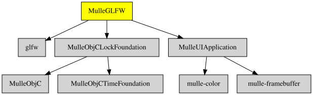

# MulleGLFW

#### 🌐 MulleGLFW provides platform windows and events


# MulleGLFW

#### 🌐 MulleGLFW provides platform windows and events

This is an Objective-C wrapper around GLFW3 to provide windows and events.
It provides the meat and potatoes code for **UIEvent** and **UIApplication**
through categories. **UIWindow** owns one more more **GLFWOSWindows**.

The GLFW3 window object is **GLFWOSWindow**. Each GLFWOSWindow has an implicit
graphics context, that will be later used by a CGContext.


| Release Version                                       | Release Notes  | AI Documentation
|-------------------------------------------------------|----------------|---------------
|  [](//github.com/MulleUI/MulleGLFW/actions) | [RELEASENOTES](RELEASENOTES.md) | [DeepWiki for MulleGLFW](https://deepwiki.com/MulleUI/MulleGLFW)


### You are here




## Add

Use [mulle-sde](//github.com/mulle-sde) to add MulleGLFW to your project:

``` sh
mulle-sde add github:MulleUI/MulleGLFW
```

To only add the sources of MulleGLFW with dependency
sources use [clib](https://github.com/clibs/clib):


``` sh
clib install --out src/MulleUI MulleUI/MulleGLFW
```

Add `-isystem src/MulleUI` to your `CFLAGS` and compile all the sources that were downloaded with your project.


## Install

Use [mulle-sde](//github.com/mulle-sde) to build and install MulleGLFW and all dependencies:

``` sh
mulle-sde install --prefix /usr/local \
   https://github.com/MulleUI/MulleGLFW/archive/latest.tar.gz
```

### Legacy Installation

Install the requirements:

| Requirements                                 | Description
|----------------------------------------------|-----------------------
| [glfw](https://github.com/glfw/glfw)             | 
| [MulleUIApplication](https://github.com/MulleUI/MulleUIApplication)             | 𝄢 MulleUIApplication provides abstract classes like UIApplication and UIEvent
| [mulle-objc-list](https://github.com/mulle-objc/mulle-objc-list)             | 📒 Lists mulle-objc runtime information contained in executables.

Download the latest [tar](https://github.com/MulleUI/MulleGLFW/archive/refs/tags/latest.tar.gz) or [zip](https://github.com/MulleUI/MulleGLFW/archive/refs/tags/latest.zip) archive and unpack it.

Install **MulleGLFW** into `/usr/local` with [cmake](https://cmake.org):

``` sh
PREFIX_DIR="/usr/local"
cmake -B build                               \
      -DMULLE_SDK_PATH="${PREFIX_DIR}"       \
      -DCMAKE_INSTALL_PREFIX="${PREFIX_DIR}" \
      -DCMAKE_PREFIX_PATH="${PREFIX_DIR}"    \
      -DCMAKE_BUILD_TYPE=Release &&
cmake --build build --config Release &&
cmake --install build --config Release
```


## Author

[Nat!](https://mulle-kybernetik.com/weblog) for Mulle kybernetiK  


