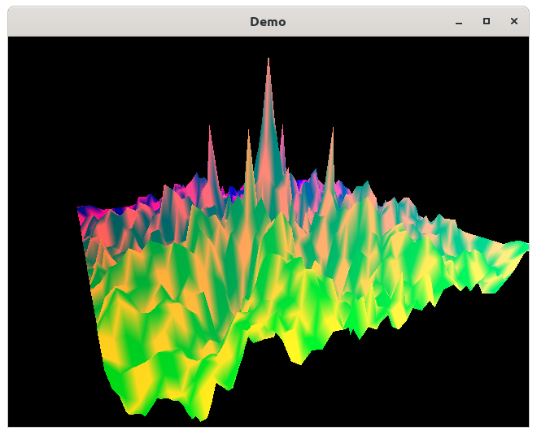
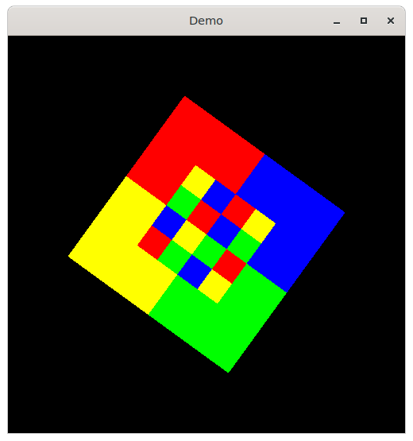
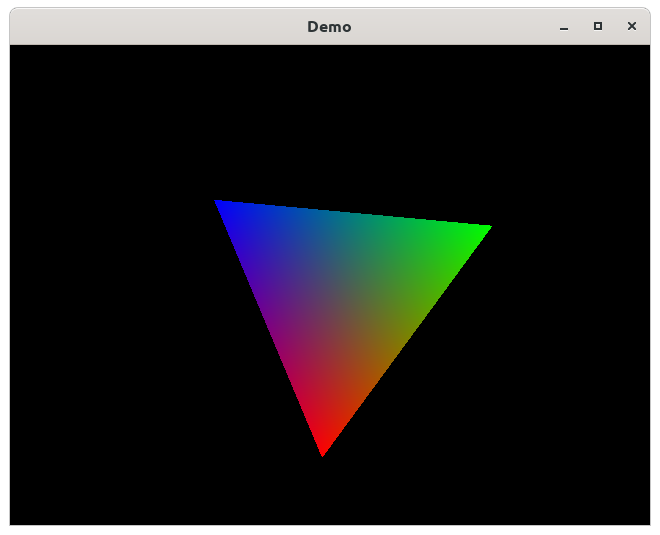
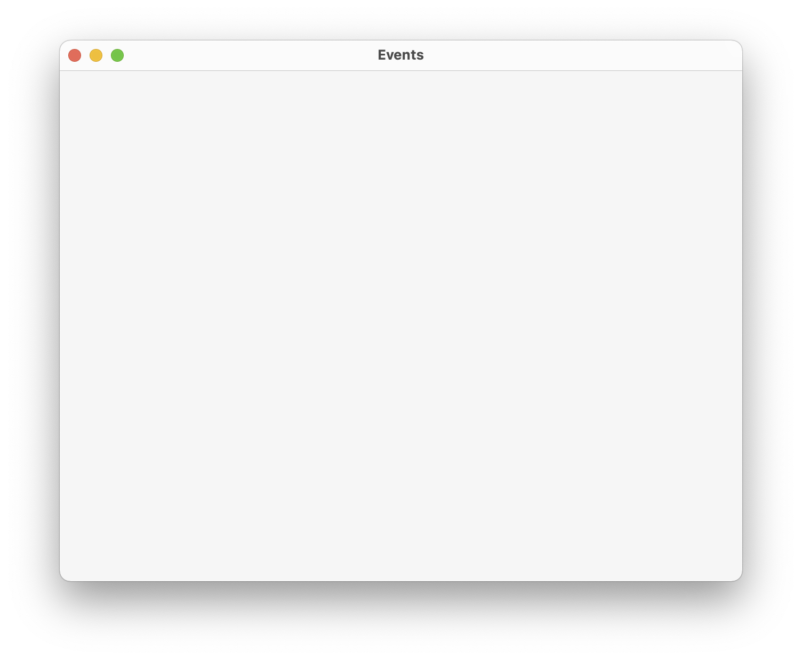

# demo

OpenGL demo of MulleGLFW. These demo should run on all platforms that
are supported by glfw3 and have OpenGL.


```
TODO:  Fullscreen demo
       Multiple Monitor demo
```
### glfw-window

This most basic demo, just puts up a window with nothing in it. You can
pass `--async`, `--synced`, `--unsynced` as command line arguments. The
window background should be a green color.


### glfw-wave

Based on glfw-wave-original.

Shows UIEvents being accepted. The draw code has been moved to a render loop.
Animations have been moved to a timer.
Window creation is done with GLFWOSWindows. Overall, setup is simplified. Event
handling is more complicated, but UIEvents will be a win starting when we
distribute them to individual UIViews in later projects. The framerate is set
to the VSYNC of the monitor.




[src/main-glfw-wave.m](src/main-glfw-wave.m)


### glfw-wave-original

Stolen demo from [glfw](//glfw.org) examples. Minimal changes to accomodate
not having "Glad". This is meant as a reference for


### glfw-texture

Most basic OpenGL texture mapping demo. **UIApplication** is used to
initialize GLFW. Then a GLFWOSWindows is created and a render callback
installed. Finally UIEvent handles event processing and sets a fixed
framerate.



[src/main-glfw-texture.m](src/main-glfw-texture.m)

### glfw-triangle-opengles / glfw-triangle-opengl

Stolen demo from [glfw](//glfw.org) examples. Demonstrates how to specify a
certain API for drawing. This demo accepts a lot of options, to change the
OpenGL API to be used. Use `glfw-triangle-opengles -h` to see whats available.



[src/main-glfw-triangle-opengles.m](src/main-glfw-triangle-opengles.m)

[src/main-glfw-triangle-opengl.m](src/main-glfw-triangle-opengl.m)

The slightly modified original code, that runs without glad on macOS.

[src/main-glfw-triangle-opengl-original.m](src/main-glfw-triangle-opengl-original.m)

### glfw-gears

Stolen demo from [glfw](//glfw.org) examples. Demonstrates how to remove
window adornments and to draw with transparencey.


[src/main-glfw-gears.m](src/main-glfw-gears.m)


### glfw-events-c / glfw-events-objc / glfw-events

glfw-events-c is the most basic window opener and event catcher. This demo is
useful to get going on an unknown platform first. There is no Objective-C
involved yet. This leads to glfw-events-objc which is the same, but uses
GLFWOSWindow. Finally glfw-events used UIEvents and UIApplication.



[src/main-glfw-events-c.m](src/main-glfw-events-c.m)

[src/main-glfw-events-objc.m](src/main-glfw-events-objc.m)

[src/main-glfw-events.m](src/main-glfw-events.m)


## Build

This is a [mulle-sde](https://mulle-sde.github.io/) project.

It comes with its own virtual environment and list of dependencies.
To fetch and build everything say:

```
mulle-sde craft --[release|debug]
```

The resultant demo will be in `kitchen/{Release/Debug}`.

## Running with Mesa debug libraries

To run any demo against the Mesa debug build in `/opt/mesa/debug/` instead of
the system GL driver, use the provided helper script:

```bash
# Default: runs glfw-triangle-opengl
./run-with-mesa-debug.sh

# Run any other demo
./run-with-mesa-debug.sh glfw-gears
./run-with-mesa-debug.sh glfw-wave
```

The script sets these environment variables:

| Variable | Value | Purpose |
|---|---|---|
| `LD_LIBRARY_PATH` | `/opt/mesa/debug/26.2.0-devel/lib/x86_64-linux-gnu` | Load Mesa's libGLX/libEGL instead of system |
| `LIBGL_DRIVERS_PATH` | `…/dri` | Where Mesa looks for DRI drivers (e.g. radeonsi, swrast) |
| `__GLX_VENDOR_LIBRARY_NAME` | `mesa` | Tell glvnd to pick Mesa over nvidia/other |
| `MESA_DEBUG` | `1` | Enable Mesa debug output |

You can verify Mesa is active by checking the GL version string — Mesa reports
**GL 4.6.0** whereas the nvidia driver reports 3.2.0.

For GDB tracing into Mesa source:
```bash
MESA=/opt/mesa/debug/26.2.0-devel
LD_LIBRARY_PATH=$MESA/lib/x86_64-linux-gnu __GLX_VENDOR_LIBRARY_NAME=mesa \
  gdb kitchen/Debug/glfw-triangle-opengl
# Inside gdb:
# set substitute-path /mesa /home/src/srcU/mesa
```

